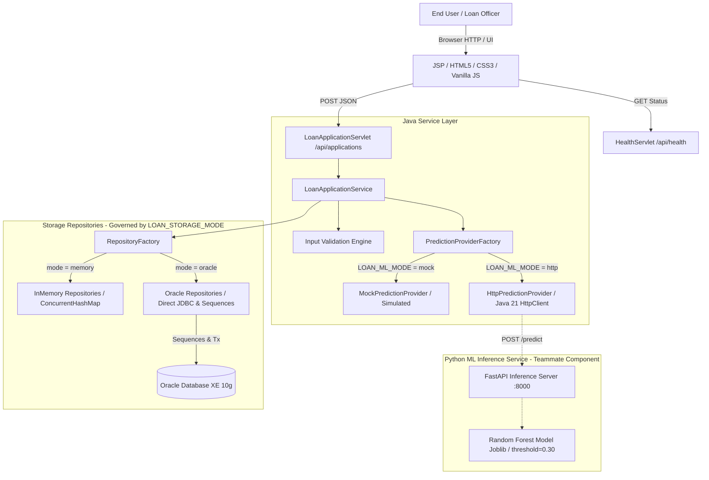

# Loan Risk Prediction Using Machine Learning

## 1. Project Overview

The **Loan Risk Prediction Using Machine Learning** project is an enterprise web application designed to evaluate loan applicant data and predict credit/loan risk using a machine learning model. The system integrates a traditional Java/Jakarta EE web application with a specialized Python-based machine learning inference service, backed by persistent operational storage (Oracle Database or In-Memory development storage).

> **Documentation Quick Links:**
> - 📘 **[Student & Developer Walkthrough Guide](file:///D:/Projects/Loan%20Default%20Risk%20Prediction/docs/project-walkthrough.md):** Complete beginner-friendly code tour, end-to-end request lifecycle, viva questions & answers, and architecture explanations.
> - 🤖 **[ML Teammate Integration Package](file:///D:/Projects/Loan%20Default%20Risk%20Prediction/docs/ml-integration-handoff.md):** HTTP specification, request/response JSON schemas, model-owner responsibilities, and acceptance checklist.

---

## 2. Current Status

The workspace currently contains:
1. **Repository & Build:** NetBeans-scaffolded Apache Ant web application structure targeting Java 21 LTS and Apache Tomcat 10.1 (Jakarta EE 10 / Servlet 6.0).
2. **Simplified Clean Architecture:** Exactly two Servlets (`LoanApplicationServlet` and `HealthServlet`), direct Repository implementations (`InMemory*` and `Oracle*`) without redundant DAO delegate layers, and clean separation of concerns.
3. **Reconciled Database Schema:** Oracle 10g XE DDL script in [`database/schema.sql`](file:///D:/Projects/Loan%20Default%20Risk%20Prediction/database/schema.sql) with sequence generators, foreign keys, and constraints.
4. **Dual Storage Architecture:** Storage-agnostic repository interfaces (`LoanApplicationRepository`, `PredictionRecordRepository`) supporting both `oracle` (JDBC / sequences) and `memory` (thread-safe ConcurrentHashMap / AtomicLong) modes, governed by `LOAN_STORAGE_MODE`.
5. **Hardened Configuration & ML Provider Subsystem:** Clean separation between simulated development (`LOAN_ML_MODE=mock`) and real HTTP inference (`LOAN_ML_MODE=http`), powered by `HttpPredictionProvider` using built-in Java 21 `HttpClient` with configurable connect and request timeouts. Strict validation prevents silent fallbacks.
6. **Repeatable Ant Testing Pipeline:** Dedicated Ant targets (`ant test`, `ant verify`) compiling test classes to `build/test/classes` completely separated from the production classes, enforcing `failonerror="true"` on execution, and executing 22/22 unit and contract test scenarios with 100% pass rate.
7. **Standardized API Contract & Status Codes:** Standardized `POST /api/applications` returning `201 Created` on success, `400 Bad Request` on validation failure, `502 Bad Gateway` on upstream ML provider outage (preserving the persisted `applicationId`), and `500 Internal Server Error` on persistence failure.
8. **Premium Fintech Analytics Frontend:** Modern dark midnight-navy JSP/CSS/JavaScript interface in [`web/index.jsp`](file:///D:/Projects/Loan%20Default%20Risk%20Prediction/web/index.jsp) featuring ambient grid backdrop, technical hero with dynamic cursor spotlight, sequence workflow indicator (`01 INPUT → 02 INFERENCE → 03 RECORD`), quick-fill test cases, high-contrast inputs with focus glow, spotlight result card with risk probability gauge bar (30% decision threshold indicator), responsive media queries, and 100% `textContent` / DOM-node rendering for total XSS safety.
9. **Verified Live Local Workflow:** Successfully deployed and verified against local Apache Tomcat 10.1 (`8081`) and validated via headless Chromium Edge DOM inspection (376 DOM lines).
10. **Build & Distribution Artifact:** Final WAR package assembled and preserved at [`dist/Loan_Default_Risk_Prediction.war`](file:///D:/Projects/Loan%20Default%20Risk%20Prediction/dist/Loan_Default_Risk_Prediction.war) (187,932 bytes).

> **Important Architecture & ML Notice:** The application currently defaults to `LOAN_STORAGE_MODE=memory` and `LOAN_ML_MODE=mock` for zero-prerequisite development. In mock mode, predictions are simulated (`mock-v1-simulated`) and do not reflect real ML decisions. The HTTP adapter (`HttpPredictionProvider`) is ready to connect to the teammate's Python/FastAPI service once launched. Automated tests used an in-process HTTP stub to verify contract compliance without claiming the external Python service was executed.

---

## 3. Architecture & Separation of Concerns



### Architectural Safeguards & Simplifications
- **Exactly Two Servlets:** `LoanApplicationServlet` controls the application lifecycle; `HealthServlet` monitors operational status.
- **Direct Repositories:** Eliminated redundant DAO intermediate classes. `OracleLoanApplicationRepository` and `OraclePredictionRecordRepository` manage their own SQL directly, keeping the codebase student-friendly.
- **Storage Independence:** Service and servlet layers depend strictly on repository interfaces, enabling frictionless testing and development without live database dependencies.
- **Strict Configuration Enforcement:** If `oracle` or `http` mode is configured, the application strictly communicates with those systems. It **never** silently falls back to `memory` or `mock`.
- **Transaction & ML Separation:** In Oracle mode, loan application records are committed to the database before calling the ML provider, ensuring external HTTP network calls never hold database locks or connections open.
- **Fail-Safe Processing Result:** When prediction inference fails after application persistence, the server returns HTTP `502 Bad Gateway` with the recorded `applicationId`, clearly distinguishing external inference outages from internal database failures (`500`).

---

## 4. ML Experimentation Results & Feature Contract

Machine learning experimentation was conducted in a Kaggle notebook environment. Baseline evaluated was Logistic Regression; the selected refitted model was Random Forest evaluated at decision threshold `0.30`.

| Metric | Experimental Value |
| :--- | :--- |
| **Dataset Target** | `QUALITY_OF_LOAN` |
| **Target Classes** | `G` (Good) and `B` (Bad) |
| **Selected Decision Threshold** | `0.30` |
| **Accuracy** | 88.39% (0.8839) |
| **Class `B` Precision** | 47.92% (0.4792) |
| **Class `B` Recall** | 52.59% (0.5259) |
| **Class `B` F1-score** | 50.14% (0.5014) |
| **ROC-AUC** | 0.8365 |
| **Average Precision (PR-AUC)** | 0.5281 |

> **Critical Notice on Target Semantics:** Class `B` in `QUALITY_OF_LOAN` represents the experimental bad loan classification label from the training dataset. **It is not confirmed as a legal or financial loan default outcome**, nor does it dictate an automated loan approval or rejection decision. The business and domain meaning of `B` must be verified and specified separately before final decision-making logic is locked.

### Nine Input Features Contract

| # | Feature Name | Java Type | Schema / Oracle Type | Category / Description |
| :-: | :--- | :--- | :--- | :--- |
| 1 | `INVESTMENT_TOTAL` | `BigDecimal` | `NUMBER(15, 2)` | Numeric: Total loan/investment requested (> 0) |
| 2 | `ACCCURRENTBALANCE` | `BigDecimal` | `NUMBER(15, 2)` | Numeric: Applicant current account balance (can be negative for overdraft) |
| 3 | `INF_MARITAL_STATUS` | `String` | `VARCHAR2(30)` | Categorical: Marital status (preserved text) |
| 4 | `INF_GENDER` | `String` | `VARCHAR2(10)` | Categorical: Gender (preserved text) |
| 5 | `INSTALL_SIZE` | `BigDecimal` | `NUMBER(15, 2)` | Numeric: Installment payment size (> 0) |
| 6 | `DUE_PAYMENT` | `BigDecimal` | `NUMBER(15, 2)` | Numeric: Amount due for payment (>= 0) |
| 7 | `COMPENSATION_CHARGED` | `String` | `VARCHAR2(30)` | Categorical: Compensation/penalty fee charged status (reconciled as text) |
| 8 | `CLIENT_TYPE` | `String` | `VARCHAR2(30)` | Categorical: Client classification type (preserved text) |
| 9 | `REPAY_MODE` | `String` | `VARCHAR2(30)` | Categorical: Repayment mode/channel (preserved text) |

---

## 5. Configuration Reference

The application is configured using environment variables, JVM system properties, or servlet context initialization parameters in `web.xml`:

| Variable / Property | Permitted Values | Default | Description |
| :--- | :--- | :--- | :--- |
| `LOAN_STORAGE_MODE`<br>`loan.storage.mode` | `memory`, `oracle` | `memory` | Active persistence repository. Throws `IllegalStateException` on any other value. |
| `LOAN_ML_MODE`<br>`loan.ml.mode` | `mock`, `http` | `mock` | Active prediction provider. Selects `MockPredictionProvider` or `HttpPredictionProvider`. |
| `LOAN_ML_BASE_URL`<br>`loan.ml.baseUrl` | Valid HTTP/HTTPS URL | *Required if `http`* | Target URL of the Python inference service (e.g., `http://localhost:8000`). |
| `LOAN_ML_CONNECT_TIMEOUT_MS`<br>`loan.ml.connectTimeoutMs` | Integer > 0 | `3000` | HTTP connect timeout in milliseconds. |
| `LOAN_ML_REQUEST_TIMEOUT_MS`<br>`loan.ml.requestTimeoutMs` | Integer > 0 | `5000` | HTTP response read timeout in milliseconds. |
| `LOAN_DB_USER`<br>`loan.db.user` | String | *Empty* | Oracle database username (required when storage mode is `oracle`). |
| `LOAN_DB_PASSWORD`<br>`loan.db.password` | String | *Empty* | Oracle database password. |
| `LOAN_DB_URL`<br>`loan.db.url` | String | `jdbc:oracle:thin:@localhost:1521:XE` | Oracle database connection string. |

---

## 6. Python ML Service HTTP Contract & Handoff

> **Full Handoff Package:** See [`docs/ml-integration-handoff.md`](file:///D:/Projects/Loan%20Default%20Risk%20Prediction/docs/ml-integration-handoff.md) for the complete integration specification, model-owner responsibilities, and acceptance checklist.

When `LOAN_ML_MODE=http`, the Java backend invokes the Python service via HTTP POST:

- **Endpoint:** `POST {LOAN_ML_BASE_URL}/predict`
- **Request Headers:** `Content-Type: application/json`, `Accept: application/json`
- **Request Body (JSON):**
  ```json
  {
    "INVESTMENT_TOTAL": 75000.00,
    "ACCCURRENTBALANCE": 18500.00,
    "INF_MARITAL_STATUS": "Married",
    "INF_GENDER": "Male",
    "INSTALL_SIZE": 3500.00,
    "DUE_PAYMENT": 850.00,
    "COMPENSATION_CHARGED": "No",
    "CLIENT_TYPE": "Individual",
    "REPAY_MODE": "Auto-Debit"
  }
  ```
- **Expected Success Response (200 OK):**
  ```json
  {
    "predicted_class": "B",
    "probability_b": 0.3542,
    "threshold_used": 0.3000,
    "model_version": "rf-v1.0"
  }
  ```
- **Validation Rules & Error Handling:**
  - `predicted_class` must be strictly `"G"` or `"B"`.
  - `probability_b` and `threshold_used` must be numbers between `0.0` and `1.0`.
  - Upstream non-200 responses, connection failures, timeouts, and malformed JSON trigger a structured `PredictionException` without application crashing or transaction corruption.

---

## 7. Repeatable Testing Through Ant

Automated testing is integrated into the NetBeans Ant build via dedicated targets:

```powershell
# Run the automated test suite
& "C:\Program Files\NetBeans-21\netbeans\extide\ant\bin\ant.bat" test

# Run the test suite and assemble the production WAR on success
& "C:\Program Files\NetBeans-21\netbeans\extide\ant\bin\ant.bat" verify
```

### Build & Isolation Architecture
- **Separate Test Directory:** Test classes compile to `build/test/classes` while production classes compile to `build/web/WEB-INF/classes`. Test classes are excluded from the distribution WAR.
- **Fail-Fast Build Result:** The `test` target executes with `fork="true"` and `failonerror="true"`. Any test failure causes the Ant build to fail immediately with exit code 1.
- **Zero Heavyweight Dependencies:** The test suite uses Java 21's built-in `com.sun.net.httpserver.HttpServer` on ephemeral ports, requiring no third-party testing frameworks.

### Test Coverage Summary (22 / 22 Passed)

| Suite | Test Cases | Scope & Verifications | Status |
| :--- | :---: | :--- | :---: |
| **Configuration Tests** (`ConfigurationTest`) | 7 | Validates `memory` and `oracle` storage modes, `mock` and `http` ML modes, rejection of missing base URL, validation of malformed timeouts, and strict zero-silent-fallback guarantees. | **PASS** |
| **HTTP Provider Contract Tests** (`HttpPredictionProviderTest`) | 9 | Runs against an in-process `HttpServer` stub on an ephemeral port. Validates successful serialization of all 9 features, preserved categorical strings with special characters, handling of HTTP 4xx/5xx errors, connection refusal, malformed JSON, out-of-range probabilities, invalid classes, and model version preservation. | **PASS** |
| **Application Workflow Tests** (`ApplicationWorkflowTest`) | 6 | Validates end-to-end loan application processing, primary-foreign key association between `LoanApplication` and `PredictionRecord`, rejection of invalid inputs, upstream prediction outage handling, persistence failure handling, and simulation flag distinction. | **PASS** |

---

## 8. API Endpoints & Status Codes Specification

### 1. `GET /api/health`
Reports runtime health, active storage mode, application count, and provider status:
```json
{
  "status": "UP",
  "timestamp": "2026-10-15T23:28:24.116Z",
  "runtime": { "javaVersion": "21.0.12", "serverInfo": "Apache Tomcat/10.1.57" },
  "storage": {
    "mode": "memory",
    "status": "IN_MEMORY_ACTIVE",
    "disclaimer": "Running in-memory storage mode. Records will be lost when application restarts and must never be used for production.",
    "storedApplicationsCount": 1
  },
  "mlService": {
    "mode": "mock",
    "simulated": true,
    "providerClass": "MockPredictionProvider",
    "status": "MOCK_PROVIDER_ACTIVE",
    "disclaimer": "Using simulated MockPredictionProvider. Outputs are for development and testing only, not genuine ML predictions."
  }
}
```

### 2. `POST /api/applications`
Processes applicant data, validates the 9 features, persists the record, and invokes the prediction provider:

| Status Code | Condition | Response Payload Schema |
| :--- | :--- | :--- |
| **`201 Created`** | Both application and prediction persisted successfully | `{"status": "SUCCESS", "applicationId": 1001, "prediction": {"predictionId": 5001, "modelVersion": "...", "predictedClass": "G", "probabilityB": 0.20, "thresholdUsed": 0.30, "simulated": true/false}}` |
| **`400 Bad Request`** | Input validation failed on any of the 9 features | `{"status": "VALIDATION_FAILED", "message": "...", "errors": {"INVESTMENT_TOTAL": "..."}}` |
| **`502 Bad Gateway`** | Application was committed, but external prediction provider failed | `{"status": "PREDICTION_FAILED", "applicationId": 1001, "message": "..."}` |
| **`500 Internal Error`** | Application database persistence failed, OR prediction record save failed | `{"status": "DATABASE_ERROR" / "PREDICTION_PERSISTENCE_FAILED", "message": "..."}` |

---

## 9. Live Verification & Testing Results

All runtime verification tests were conducted against the live Apache Tomcat 10.1 server at `http://localhost:8081/Loan_Default_Risk_Prediction/`:

| Test Case | Method & Target | Expected Result | Actual Result | Status |
| :--- | :--- | :--- | :--- | :--- |
| **Health Check** | `GET /api/health` | 200 OK, mode `memory`, ML mode `mock` | HTTP 200 OK, dual mode reporting, `storedApplicationsCount: 1` | **PASS** |
| **Frontend UI Render** | `GET /` | 200 OK, renders HTML/CSS form & disclaimer | HTTP 200 OK, rendered cleanly | **PASS** |
| **Headless Edge DOM Render** | `msedge --dump-dom` | Full Chromium DOM parsed with all 9 features | 376 DOM lines rendered, zero console crashes | **PASS** |
| **Standard Application Submission** | `POST /api/applications` | 201 Created, assigned IDs, `predictedClass: G` | HTTP 201 Created, `applicationId: 1001`, `predictionId: 5001`, `probB: 0.20` | **PASS** |
| **Invalid Input Validation** | `POST /api/applications` | 400 Bad Request with field errors | HTTP 400 Bad Request with 9 field validation errors | **PASS** |
| **In-Memory Accumulation** | `GET /api/health` | Counter increments with each submission | Confirmed count incremented from 0 to 1 | **PASS** |
| **Zero-XSS Safe Rendering** | Static & runtime check | Zero `innerHTML` usage with untrusted dynamic data | Confirmed 100% `textContent` and DOM nodes | **PASS** |
| **Mobile-First Responsive Layout** | CSS `@media` inspection | Single column on < 600px and < 900px | Verified `layout-grid` and `form-grid` media queries | **PASS** |
| **Ant Repeatable Testing** | `ant test` | Compiles test classes, runs 22 tests | All 22 tests passed, build successful | **PASS** |

---

## 10. Build & Distribution Artifact

- **Build Tool:** Apache Ant 1.10.14 (`ant verify` / `ant dist`)
- **Compilation:** Clean compilation with zero errors across all core and test classes.
- **Packaging:** Assembled into `dist/Loan_Default_Risk_Prediction.war` (187,932 bytes).
- **Artifact Policy:** Artifact is preserved in `dist/` and has **not** been cleaned.

---

## 11. Phase Roadmap

- [x] **Phase 1: Read-Only Technical Reconnaissance** — Inspected workspace structure, verified installed runtimes and tools, confirmed absence of source/ML assets, and verified isolation from external projects.
- [x] **Phase 2: Repository Foundation & Documentation** — Initialized Git repository on `main` branch, established root `.gitignore`, and authored project `README.md`.
- [x] **Phase 4: Oracle Database Schema Preparation & Reconciliation** — Designed Oracle 10g XE schema in `database/schema.sql`, reconciled `COMPENSATION_CHARGED` as categorical, and established sequences and constraints.
- [x] **Phase 4.1–6: Java Backend Foundation & Persistence** — Implemented layered architecture (Config, Models, DAOs, Mock ML Provider, Service, Servlets), transaction separation, and Ant packaging.
- [x] **Phase 7–8: Runtime & JDBC Compatibility Assessment** — Discovered driver incompatibility between Java 21 / modern drivers and legacy Oracle 10g; documented requirement for compatible driver bridge.
- [x] **Phase 9–11: Storage Abstraction, Complete Frontend & Demo Workflow** — Implemented dual storage modes (`memory` and `oracle`), built complete responsive frontend (`index.jsp`, `style.css`, `app.js`), verified live on Tomcat 10.1 with zero database prerequisites, and confirmed strict error handling.
- [x] **Phase 12–14: HTTP ML Adapter, Automated Contract Testing & Backend Hardening** — Implemented `HttpPredictionProvider` via Java 21 `HttpClient`, created `MlConfig` and `PredictionProviderFactory` with zero silent fallback, implemented 22 unit & contract test scenarios using an in-process HTTP stub, hardened frontend UI, packaged WAR, and verified on Tomcat 10.1.
- [x] **Phase 15–17: Release Readiness, Repeatable Testing, and ML Integration Handoff** — Added repeatable Ant targets (`test`, `verify`) with `failonerror="true"`, standardized HTTP status codes (201, 400, 500, 502), eliminated all `innerHTML` vectors for XSS safety, authored teammate integration handoff package in `docs/ml-integration-handoff.md`, preserved production WAR, and verified on Tomcat 10.1.
- [x] **Phase 18: Simplify Architecture & Author Student Walkthrough** — Consolidated redundant DAO layer into direct repositories (eliminating `com.loanrisk.dao`), confirmed exactly 2 Servlets, authored comprehensive beginner-friendly walkthrough with viva Q&A in `docs/project-walkthrough.md`, ran `ant verify` (22/22 tests passing), and verified WAR.
- [x] **Phase 19: Premium AI-Powered Fintech Frontend Redesign** — Redesigned frontend into a dark midnight-navy analytics UI with ambient mesh background, interactive cursor-following hero spotlight, sequence workflow indicator (`01 INPUT → 02 INFERENCE → 03 RECORD`), refined form controls with glow states, spotlight risk prediction card with probability gauge bar (30% decision threshold indicator), zero-external-dependency vanilla CSS/JS, 22/22 Ant tests passing, and verified against Tomcat 10.1.
- [x] **Phase 19.1: Frontend Compatibility and Prediction Semantics Correction** — Restored neutral prediction semantics: replaced "risk probability" with "Class B probability", removed unsupported risk/prime labels, neutralized sample buttons to "Synthetic Example 1" and "Synthetic Example 2", ensured free-text inputs for all 5 categorical features, confirmed all 31 original JS element IDs resolve, rendered probability gauge in single consistent accent with provider-driven threshold marker, 22/22 tests passing, and verified live on Tomcat 10.1.
- [ ] **Python ML Inference Service Deployment:** (Developed independently by teammate) Expose trained Random Forest model (`threshold=0.30`) over FastAPI `/predict` endpoint matching [`docs/ml-integration-handoff.md`](file:///D:/Projects/Loan%20Default%20Risk%20Prediction/docs/ml-integration-handoff.md).
- [ ] **Live Oracle Database Deployment:** Provision database credentials, place compatible driver bridge in Tomcat `lib/`, execute `database/schema.sql`, and run with `LOAN_STORAGE_MODE=oracle`.
- [ ] **End-to-End Multi-Tier Verification:** End-to-end integration test across Browser -> Tomcat -> Oracle DB -> Python FastAPI service.
