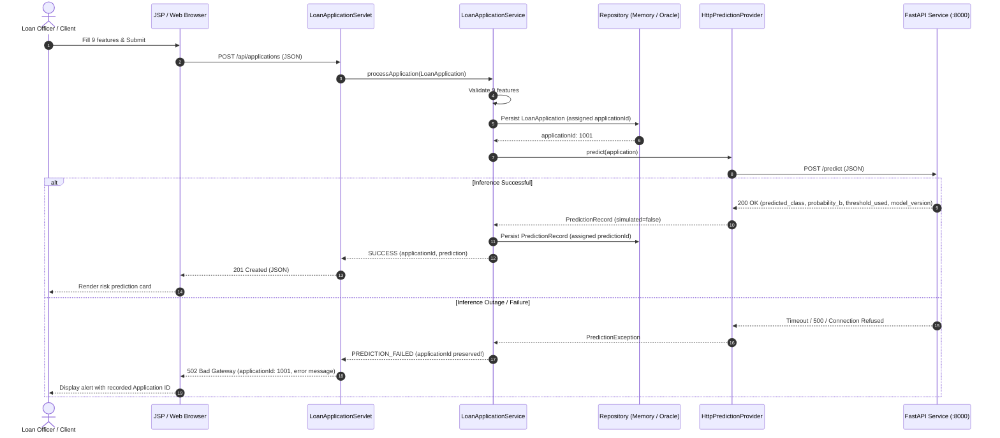

# Machine Learning Service Integration Handoff Package

**Document Version:** 1.0  
**Project:** Loan Default Risk Prediction  
**Java Backend Version:** Java 21 LTS / Apache Tomcat 10.1  
**Target ML Inference Service:** Python 3.14 / FastAPI / Scikit-learn  
**Status:** Ready for Teammate ML Service Implementation  

---

## 1. Purpose & Architecture Overview

This document specifies the exact technical contract for the standalone Python/FastAPI Machine Learning inference service.

The Java application backend serves as the primary system of record and user portal. When configured with `LOAN_ML_MODE=http`, the Java backend invokes the Python inference service via [`HttpPredictionProvider`](file:///D:/Projects/Loan%20Default%20Risk%20Prediction/src/java/com/loanrisk/ml/HttpPredictionProvider.java) using Java 21's `java.net.http.HttpClient`.



---

## 2. HTTP Request Specification

### Endpoint & Protocol

- **HTTP Method:** `POST`
- **Path:** `/predict` (relative to `LOAN_ML_BASE_URL`, e.g., `http://localhost:8000/predict`)
- **Headers:**
  - `Content-Type: application/json`
  - `Accept: application/json`

### Nine Input Features Contract

The Java adapter sends exactly the nine features documented below. Feature names match the schema and dataset column names in uppercase.

| # | Feature Key | Data Type | Constraint / Validation | Description & Handling |
| :-: | :--- | :--- | :--- | :--- |
| 1 | `INVESTMENT_TOTAL` | Numeric (Float/Decimal) | > 0.00 | Total loan/investment requested. |
| 2 | `ACCCURRENTBALANCE` | Numeric (Float/Decimal) | Any real number | Current account balance. Can be negative for overdraft. |
| 3 | `INF_MARITAL_STATUS` | String | Non-empty, max 30 chars | Applicant marital status (e.g., `"Married"`, `"Single"`, `"Divorced"`). |
| 4 | `INF_GENDER` | String | Non-empty, max 10 chars | Applicant gender (e.g., `"M"`, `"F"`, `"Male"`, `"Female"`). |
| 5 | `INSTALL_SIZE` | Numeric (Float/Decimal) | > 0.00 | Installment payment size per period. |
| 6 | `DUE_PAYMENT` | Numeric (Float/Decimal) | >= 0.00 | Current due payment amount. |
| 7 | `COMPENSATION_CHARGED` | String | Non-empty, max 30 chars | Compensation/penalty charge status (e.g., `"None"`, `"Waived"`, `"Charged"`, `"No"`). |
| 8 | `CLIENT_TYPE` | String | Non-empty, max 30 chars | Client classification (e.g., `"Individual"`, `"Corporate"`). |
| 9 | `REPAY_MODE` | String | Non-empty, max 30 chars | Repayment mode/channel (e.g., `"Monthly"`, `"Quarterly"`, `"Auto-Debit"`). |

### Handling Rules for Input Data
1. **Preserve Categorical Strings:** The Java backend sends categorical features as raw strings. The Python service must handle encoding internally (e.g., via a saved Scikit-learn `Pipeline`, `ColumnTransformer`, or `OneHotEncoder` / `OrdinalEncoder` with `handle_unknown='ignore'`).
2. **Missing or Invalid Fields:** If any required feature is missing or cannot be parsed, the Python service should return HTTP `422 Unprocessable Entity` or `400 Bad Request` with a descriptive JSON error body.

### Representative Synthetic Request Payload

> **Notice:** The values below are synthetic illustrative test data for contract verification.

```json
{
  "INVESTMENT_TOTAL": 75000.00,
  "ACCCURRENTBALANCE": 18500.00,
  "INF_MARITAL_STATUS": "Married",
  "INF_GENDER": "Male",
  "INSTALL_SIZE": 3500.00,
  "DUE_PAYMENT": 850.00,
  "COMPENSATION_CHARGED": "No",
  "CLIENT_TYPE": "Individual",
  "REPAY_MODE": "Auto-Debit"
}
```

---

## 3. HTTP Response Specification

### Response Schema (HTTP 200 OK)

The Python service must return a JSON object containing the following keys:

| Property Name | Type | Permitted Values / Constraints | Description |
| :--- | :--- | :--- | :--- |
| `predicted_class` | String | `"G"` or `"B"` (case-insensitive) | Predicted `QUALITY_OF_LOAN` class label. |
| `probability_b` | Float / Numeric | `0.0 <= probability_b <= 1.0` | Probability of Class `B` produced by the model (e.g., `predict_proba`). |
| `threshold_used` | Float / Numeric | `0.0 <= threshold_used <= 1.0` | Decision threshold applied to assign Class `B` (e.g., `0.30`). |
| `model_version` | String | Non-empty string | Version tag of the trained model artifact (e.g., `"rf-v1.0"`). |

### Target Class & Probability Semantics
- **Target Variable:** `QUALITY_OF_LOAN`.
- **Target Classes:** `G` (Good / Standard Risk) and `B` (Bad / Elevated Risk).
- **Decision Rule:** `predicted_class` is `"B"` if `probability_b >= threshold_used`, otherwise `"G"`.
- **Threshold Recommendation:** Experimental baseline identified `threshold = 0.30` to balance precision and recall on the imbalanced class `B`.

### Representative Illustrative Response

> **Notice:** The payload below is an illustrative example of the expected format.

```json
{
  "predicted_class": "B",
  "probability_b": 0.3542,
  "threshold_used": 0.3000,
  "model_version": "rf-v1.0"
}
```

### Error Responses & Status Codes

| HTTP Status | Condition | Expected JSON Body |
| :--- | :--- | :--- |
| `200 OK` | Inference executed successfully | Success payload described above. |
| `422 Unprocessable Entity` | Missing features, wrong types, or invalid range | `{"detail": [{"loc": ["body", "INVESTMENT_TOTAL"], "msg": "value must be > 0"}]}` |
| `500 Internal Server Error` | Model loading or internal inference error | `{"detail": "Model inference failed: <error description>"}` |

---

## 4. Model-Owner Responsibilities & Clarifications

Before deploying the real inference service to production, the ML model owner must verify and document the following items:

1. **Clarification of Class `B` Semantics:**
   > **Critical Notice:** Class `B` in `QUALITY_OF_LOAN` represents the bad loan classification label from the experimental training dataset. **It is NOT confirmed as a legal default, bankruptcy, or contract breach.** It must not be presented to loan officers as an automatic loan rejection. The business meaning and lending policy interpretation of `B` must be verified by credit risk leadership.
2. **Feature Schema & Preprocessing Pipeline:**
   - Confirm the full list of allowed categories for `INF_MARITAL_STATUS`, `INF_GENDER`, `COMPENSATION_CHARGED`, `CLIENT_TYPE`, and `REPAY_MODE`.
   - Ensure the preprocessing pipeline handles unseen categories gracefully (e.g., fallback category or zero-vector in one-hot encoding).
   - Document whether numeric features were scaled (e.g., `StandardScaler`, `RobustScaler`) and include the fitted scaler inside the serialized pipeline.
3. **Probability Calibration:**
   - Confirm whether `probability_b` is calibrated (e.g., using `CalibratedClassifierCV`) or raw tree probability from `predict_proba`.
   - Document whether `probability_b` represents an absolute default rate or a relative ranking score.
4. **Threshold Selection & Validation:**
   - Document the validation procedure (e.g., Stratified K-Fold CV, Out-Of-Time validation) that justifies the decision threshold `0.30`.
   - Provide the trade-off curve (Precision-Recall curve, ROC curve) supporting this threshold.
5. **Artifact Packaging & Metadata:**
   - Package the preprocessing pipeline and trained classifier together into a single reproducible file (e.g., `loan_risk_pipeline_v1.0.joblib`).
   - Hardcode or inject the model version metadata string into the response.

---

## 5. Integration Acceptance Checklist

Once the FastAPI service is running locally, execute this 5-step checklist to certify full end-to-end integration:

- [ ] **1. Service Ping / Docs Check:**
  - Verify FastAPI is listening on `http://localhost:8000`.
  - Open `http://localhost:8000/docs` in a browser and verify OpenAPI schema for `POST /predict`.
- [ ] **2. Direct Request/Response Validation:**
  - Send the representative synthetic request using curl:
    ```bash
    curl -X POST http://localhost:8000/predict \
      -H "Content-Type: application/json" \
      -d '{"INVESTMENT_TOTAL":75000.00,"ACCCURRENTBALANCE":18500.00,"INF_MARITAL_STATUS":"Married","INF_GENDER":"Male","INSTALL_SIZE":3500.00,"DUE_PAYMENT":850.00,"COMPENSATION_CHARGED":"No","CLIENT_TYPE":"Individual","REPAY_MODE":"Auto-Debit"}'
    ```
  - Verify that the response contains `predicted_class`, `probability_b`, `threshold_used`, and `model_version`.
- [ ] **3. Input Validation Test:**
  - Send a payload with a missing field or negative `INVESTMENT_TOTAL`.
  - Verify that the service returns HTTP `422` or `400` with an error message instead of crashing.
- [ ] **4. Java Backend Integration Verification:**
  - Configure Java with:
    ```powershell
    $env:LOAN_ML_MODE = "http"
    $env:LOAN_ML_BASE_URL = "http://localhost:8000"
    ```
  - Submit an application through the web interface at `http://localhost:8081/Loan_Default_Risk_Prediction/`.
  - Verify that the UI displays `"Remote ML Service (FastAPI / Scikit-learn)"` in green, and displays the genuine model version tag (e.g., `rf-v1.0`).
- [ ] **5. Outage & Resiliency Test:**
  - Stop the FastAPI service while Java is configured for HTTP mode.
  - Submit an application via the web form.
  - Confirm that the UI displays a clean error banner stating that the application was recorded (with its assigned ID) while the prediction step failed, and that the server returned HTTP `502 Bad Gateway` without crashing.

---

## 6. Configuring the Java Backend for HTTP Inference

To switch the Java backend from simulated mock mode to the real Python service:

```powershell
# Set environment variables for Apache Tomcat or standalone execution
$env:LOAN_STORAGE_MODE = "memory"                # Or "oracle" once database is provisioned
$env:LOAN_ML_MODE = "http"                       # Activates HttpPredictionProvider
$env:LOAN_ML_BASE_URL = "http://localhost:8000"  # Target FastAPI service base URL
$env:LOAN_ML_CONNECT_TIMEOUT_MS = "3000"         # Connection timeout (default 3s)
$env:LOAN_ML_REQUEST_TIMEOUT_MS = "5000"         # Response read timeout (default 5s)
```

Alternatively, these values can be supplied as JVM system properties:
`-Dloan.ml.mode=http -Dloan.ml.baseUrl=http://localhost:8000`
