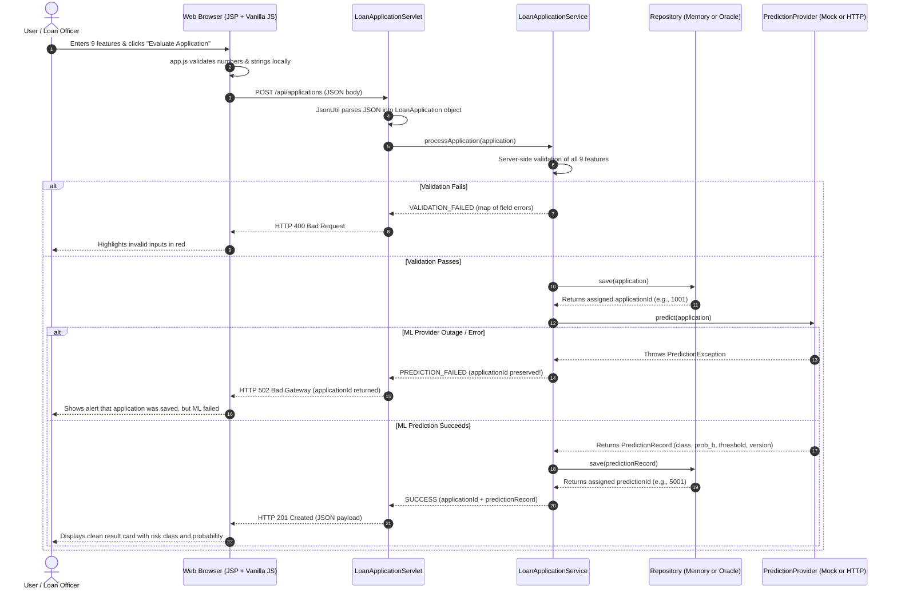

# Developer Walkthrough & Student Guide

**Project:** Loan Default Risk Prediction  
**Technology Stack:** Java 21 LTS | Jakarta Servlets 6.0 & JSP | Apache Tomcat 10.1 | Apache Ant | Optional Oracle XE 10g | Optional Python FastAPI ML Service  
**Audience:** College students, developers, and project evaluators  

---

## 1. Project Summary: What Does This Application Do?

This project is a complete, enterprise-style web application designed to evaluate loan applicants. An applicant or loan officer enters nine financial and demographic features into a web form. The system validates the input, records the application into storage (either fast in-memory storage for development or an Oracle database for production), and evaluates the application using a Machine Learning prediction provider.

### The Big Architectural Idea
Instead of tightly coupling the Java web application to a specific database or a local Python script, the project uses **clean interfaces and separation of concerns**:
- **Storage** is behind a `LoanApplicationRepository` interface: You can run without any database installed using the `memory` mode, or switch to `oracle` mode with a single configuration flag.
- **Machine Learning** is behind a `PredictionProvider` interface: You can develop and test offline using `MockPredictionProvider`, or connect over HTTP to a Python FastAPI service using `HttpPredictionProvider`.

---

## 2. Complete Request Flow (From Browser to Database to ML and Back)

Here is what happens step-by-step when a user submits a loan application:



### The 4 Execution Steps in `LoanApplicationService`
When `LoanApplicationServlet` calls `LoanApplicationService.processApplication(app)`:
1. **Validate:** Checks that required numbers are positive (`INVESTMENT_TOTAL > 0`, `INSTALL_SIZE > 0`, `DUE_PAYMENT >= 0`) and required strings are not blank.
2. **Persist Application:** The application is saved **before** calling ML. This guarantees the customer's application is safely recorded in the database and assigned an ID even if the ML service is down.
3. **Inference:** Calls the active `PredictionProvider` to compute the credit risk score.
4. **Persist Prediction:** The resulting prediction is saved and linked to the application ID.

---

## 3. Java Package and Class Guide

The project is structured into 7 simple packages under `src/java/com/loanrisk/`:

```text
src/java/com/loanrisk/
├── config/       # Reads configuration (storage mode, ML mode, database credentials)
├── model/        # Plain Old Java Objects (POJOs) representing domain data
├── repository/   # Data storage interfaces, in-memory implementation, and Oracle JDBC implementation
├── ml/           # Prediction interfaces, simulated mock provider, and HTTP microservice adapter
├── service/      # Business logic: input validation and workflow orchestration
├── util/         # Lightweight, dependency-free JSON parsing and formatting
└── web/          # Servlets for HTTP endpoints and lifecycle initialization
```

### 1. `com.loanrisk.web` (The Presentation Layer)
- **`LoanApplicationServlet.java`:** Listens at `POST /api/applications`. Reads the incoming request (JSON or form data), calls `LoanApplicationService`, and returns the appropriate HTTP status code (`201 Created`, `400 Bad Request`, `502 Bad Gateway`, or `500 Internal Server Error`).
- **`HealthServlet.java`:** Listens at `GET /api/health`. Reports system uptime, Java version, active storage mode (`memory` or `oracle`), stored application count, and ML provider status.
- **`AppLifecycleListener.java`:** A `ServletContextListener` that runs once when Tomcat starts. It reads default settings from `web.xml` and passes them to `StorageConfig` and `MlConfig`.

### 2. `com.loanrisk.service` (The Business Layer)
- **`LoanApplicationService.java`:** The central coordinator. It validates inputs, controls the sequence of saving and predicting, and handles error states. It does not know whether storage is in-memory or in Oracle, nor whether ML is mock or remote HTTP.
- **`ApplicationProcessingResult.java`:** A simple result container holding the outcome status (`SUCCESS`, `VALIDATION_FAILED`, `PREDICTION_FAILED`, `DATABASE_ERROR`, `PREDICTION_PERSISTENCE_FAILED`), the generated `applicationId`, and the `PredictionRecord`.
- **`ValidationResult.java`:** Holds a map of field-specific error messages (e.g., `"INVESTMENT_TOTAL": "Must be greater than zero"`).

### 3. `com.loanrisk.ml` (The Machine Learning Integration Layer)
- **`PredictionProvider.java`:** The common interface with a single method: `PredictionRecord predict(LoanApplication app) throws PredictionException`.
- **`MockPredictionProvider.java`:** An offline, simulated implementation. It calculates a deterministic risk heuristic based on applicant balance and installments, returns `simulated = true`, and sets `modelVersion = "mock-v1-simulated"`.
- **`HttpPredictionProvider.java`:** The real integration client. It uses Java 21's built-in `java.net.http.HttpClient` to send a POST request with the 9 features to the teammate's FastAPI server, validates the response, and returns `simulated = false`.
- **`PredictionProviderFactory.java`:** Inspects `LOAN_ML_MODE` and returns either `MockPredictionProvider` or `HttpPredictionProvider`.

### 4. `com.loanrisk.repository` (The Data Access Layer)
- **`LoanApplicationRepository.java` & `PredictionRecordRepository.java`:** Interfaces defining standard CRUD operations (`save`, `findById`, `findAll`).
- **`memory.InMemoryLoanApplicationRepository.java` & `memory.InMemoryPredictionRecordRepository.java`:** Thread-safe in-memory stores using `ConcurrentHashMap` and `AtomicLong` for sequential IDs. Ideal for instant local development.
- **`oracle.OracleLoanApplicationRepository.java` & `oracle.OraclePredictionRecordRepository.java`:** Direct JDBC implementations executing parameterized SQL queries against Oracle 10g XE using sequences (`LOAN_APPLICATION_SEQ`, `PREDICTION_RECORD_SEQ`).
- **`RepositoryFactory.java`:** Inspects `LOAN_STORAGE_MODE` and returns either the in-memory or Oracle repository singletons.

### 5. `com.loanrisk.config` (Configuration Subsystem)
- **`StorageConfig.java`:** Resolves `LOAN_STORAGE_MODE` (`memory` or `oracle`). Rejects invalid values immediately with `IllegalStateException`.
- **`MlConfig.java`:** Resolves `LOAN_ML_MODE` (`mock` or `http`), `LOAN_ML_BASE_URL`, and timeouts.
- **`DatabaseConfig.java`:** Manages the Oracle JDBC connection string and driver loading.

### 6. `com.loanrisk.model` (Data Entities)
- **`LoanApplication.java`:** Represents the loan application and its 9 input features.
- **`PredictionRecord.java`:** Represents the inference output: `predictedClass`, `probabilityB`, `thresholdUsed`, `modelVersion`, timestamp, and `isSimulated` flag.

### 7. `com.loanrisk.util` (Utilities)
- **`JsonUtil.java`:** Custom, lightweight JSON parser and serializer written in pure standard Java without requiring external libraries like Jackson or Gson.

---

## 4. Why Does the Project Have Exactly Two Servlets?

A common beginner mistake is creating a separate Servlet for every button or form field. In modern web engineering, Servlets are controllers that represent **business capabilities**:
1. **`LoanApplicationServlet` (`/api/applications`):** Handles everything related to loan applications (submitting an application, validating it, coordinating storage, and returning predictions).
2. **`HealthServlet` (`/api/health`):** Handles operational monitoring (checking whether Tomcat is up, which storage mode is active, and how many applications have been processed).

Static files (`index.jsp`, `css/style.css`, `js/app.js`) do not need custom Servlets; Tomcat's built-in default servlet serves them automatically.

---

## 5. Mock vs. Real HTTP Prediction Provider

| Feature | `MockPredictionProvider` | `HttpPredictionProvider` |
| :--- | :--- | :--- |
| **Execution Environment** | Runs inside Java JVM memory | Runs over the network to external Python service |
| **External Dependencies** | None | Requires running FastAPI service (`:8000`) |
| **Prediction Logic** | Simulated debt-to-income heuristic | Trained Scikit-learn Random Forest model |
| **`isSimulated()`** | `true` | `false` |
| **Model Version Tag** | `"mock-v1-simulated"` | Genuine tag returned by Python (e.g. `"rf-v1.0"`) |
| **Failure Causes** | None (always succeeds) | Network timeout, connection refused, 500 error |

Both classes implement the exact same Java interface (`PredictionProvider`), meaning the rest of the Java application does not care which one is active.

---

## 6. In-Memory Storage vs. Oracle Storage

| Property | `InMemoryLoanApplicationRepository` | `OracleLoanApplicationRepository` |
| :--- | :--- | :--- |
| **Underlying Mechanism** | `ConcurrentHashMap<Long, LoanApplication>` | Oracle JDBC `PreparedStatement` & SQL |
| **Primary Key ID** | `AtomicLong.incrementAndGet()` (1001, 1002...) | Oracle sequence `LOAN_APPLICATION_SEQ.NEXTVAL` |
| **Persistence Lifetime** | Data disappears when Tomcat restarts | Data permanently saved on disk in tables |
| **External Prerequisites** | None (zero database installation needed) | Oracle 10g XE service running + schema executed |
| **Activation** | `LOAN_STORAGE_MODE=memory` (default) | `LOAN_STORAGE_MODE=oracle` |

---

## 7. What Happens When Things Fail?

The application is engineered with defensive programming:

1. **Validation Failure (User enters invalid data):**
   - The service rejects the input immediately.
   - Database and ML are **not** called.
   - Servlet returns **HTTP 400 Bad Request** with a map of field-level errors.
   - The UI highlights the faulty fields in red.
2. **ML Inference Failure (Python service is down or times out):**
   - The loan application has **already been saved** in storage.
   - `HttpPredictionProvider` catches the connection error or timeout and throws `PredictionException`.
   - Servlet returns **HTTP 502 Bad Gateway**.
   - The response includes the generated `applicationId`!
   - The UI shows an alert: *"Application ID #1001 was recorded, but prediction step failed."* The user's application is not lost.
3. **Database Storage Failure (Oracle is full or unreachable):**
   - The repository rolls back the SQL transaction and throws `StorageException`.
   - The service stops immediately and does not call the ML provider.
   - Servlet returns **HTTP 500 Internal Server Error**.

---

## 8. Current Status: What is Complete vs. What is Pending

### Complete & Fully Working
- [x] Responsive web frontend (`index.jsp`, `style.css`, `app.js`) with sample quick-fill buttons and mobile layout.
- [x] Clean, dependency-free Java backend targeting Java 21 and Tomcat 10.1.
- [x] Dual storage subsystem (`memory` and `oracle`) with zero silent fallbacks.
- [x] Dual prediction provider subsystem (`mock` and `http`).
- [x] 22 automated unit and contract tests running via Apache Ant (`ant test`).
- [x] Web Application Archive (`dist/Loan_Default_Risk_Prediction.war`) ready for Tomcat deployment.
- [x] Machine Learning Handoff Package in [`docs/ml-integration-handoff.md`](file:///D:/Projects/Loan%20Default%20Risk%20Prediction/docs/ml-integration-handoff.md).

### Pending External Tasks (Not Blockers for Local Demo)
- [ ] **Teammate's Python ML Service:** Teammate will write the FastAPI app running the trained Random Forest model.
- [ ] **Live Oracle XE Database:** Provision database user/password and run `database/schema.sql`.

---

## 9. Developer Commands & Configuration Cheat Sheet

### 1. Run Automated Tests
```powershell
& "C:\Program Files\NetBeans-21\netbeans\extide\ant\bin\ant.bat" test
```

### 2. Verify Tests and Build Production WAR
```powershell
& "C:\Program Files\NetBeans-21\netbeans\extide\ant\bin\ant.bat" verify
```
The compiled WAR will be placed at `dist/Loan_Default_Risk_Prediction.war`.

### 3. Deploy to Tomcat
```powershell
Copy-Item "dist\Loan_Default_Risk_Prediction.war" "C:\Program Files\Apache Software Foundation\Tomcat 10.1\webapps\" -Force
```
Access in browser: `http://localhost:8081/Loan_Default_Risk_Prediction/`

### 4. How to Activate the Python ML Service
When your teammate finishes the FastAPI service:
```powershell
$env:LOAN_ML_MODE = "http"
$env:LOAN_ML_BASE_URL = "http://localhost:8000"
```

### 5. How to Activate Oracle Storage Mode
When the Oracle database is ready:
```powershell
$env:LOAN_STORAGE_MODE = "oracle"
$env:LOAN_DB_USER = "loan_app_user"
$env:LOAN_DB_PASSWORD = "your_password"
$env:LOAN_DB_URL = "jdbc:oracle:thin:@localhost:1521:XE"
```

---

## 10. College Viva & Exam Questions (With Code-Accurate Answers)

#### Q1: What architecture does this application follow?
> **Answer:** It follows a classic 3-Tier Layered Architecture:
> 1. **Presentation Layer:** JSP, CSS, Vanilla JavaScript, and Jakarta Servlets (`LoanApplicationServlet`, `HealthServlet`).
> 2. **Service / Business Layer:** `LoanApplicationService` performing server-side validation and workflow orchestration.
> 3. **Data / Integration Layer:** `LoanApplicationRepository` for database persistence and `PredictionProvider` for Machine Learning inference.

#### Q2: Why did you not use Spring Boot or Hibernate?
> **Answer:** This project is built using standard Java 21, Jakarta EE 10 Servlets, and native JDBC. This demonstrates core software engineering principles, direct HTTP request-response lifecycles, and transaction handling without the overhead, hidden magic, or heavy dependencies of third-party frameworks.

#### Q3: What is the purpose of `RepositoryFactory` and `PredictionProviderFactory`?
> **Answer:** They implement the Factory Design Pattern to decouple business logic from specific implementations. `LoanApplicationService` only interacts with abstract interfaces (`LoanApplicationRepository` and `PredictionProvider`). The factories read environment variables (`LOAN_STORAGE_MODE` and `LOAN_ML_MODE`) and instantiate the appropriate concrete class (`InMemory` vs `Oracle`, `Mock` vs `Http`).

#### Q4: How do you prevent SQL Injection in Oracle mode?
> **Answer:** We strictly use JDBC `PreparedStatement` with parameterized placeholders (`?`) for all SQL queries in `OracleLoanApplicationRepository` and `OraclePredictionRecordRepository`. User input is never concatenated directly into SQL strings.

#### Q5: How do you prevent Cross-Site Scripting (XSS) in the frontend?
> **Answer:** In `web/js/app.js`, dynamic data returned by the server (such as application IDs, error messages, and model versions) is rendered into the DOM strictly using `.textContent` and explicit DOM nodes (`document.createElement`). We eliminated all usage of `innerHTML` with untrusted data.

#### Q6: How does the Java backend communicate with the Python ML model?
> **Answer:** It uses `HttpPredictionProvider`, which leverages Java 21's built-in `java.net.http.HttpClient`. It serializes the nine input features into a JSON payload, sends an HTTP POST request to `{LOAN_ML_BASE_URL}/predict`, and parses the JSON response containing `predicted_class`, `probability_b`, `threshold_used`, and `model_version`.

#### Q7: What happens if the external Python ML service goes down?
> **Answer:** The application record is already safely saved in the database before the ML call is made. If the ML service is down, `HttpPredictionProvider` catches the connection failure or timeout and throws a `PredictionException`. `LoanApplicationServlet` returns an HTTP `502 Bad Gateway` status code along with the saved `applicationId`. The user is notified that their application was safely recorded even though risk evaluation failed.

#### Q8: What do the target classes `G` and `B` mean?
> **Answer:** They represent the `QUALITY_OF_LOAN` target classes from the training dataset (`G` = Good credit risk, `B` = Bad credit risk). Class `B` represents an experimental risk label; it is not a legal declaration of default, nor does it automatically approve or reject a loan application. Final lending decisions require policy rules.

#### Q9: Why is the decision threshold set to 0.30 instead of the standard 0.50?
> **Answer:** In credit risk datasets, bad loans (Class `B`) are typically a minority class (imbalanced dataset). Lowering the decision threshold from 0.50 to 0.30 increases model sensitivity (recall) for high-risk applicants, helping financial institutions catch more potential defaults without unacceptably sacrificing precision.

#### Q10: How do you test the application without the real Python service or Oracle database?
> **Answer:** We have an automated test suite executed with Apache Ant (`ant test`). It includes `ConfigurationTest`, `ApplicationWorkflowTest`, and `HttpPredictionProviderTest`. The HTTP test uses Java's built-in `com.sun.net.httpserver.HttpServer` to create an ephemeral, in-process HTTP stub that simulates successful responses, network timeouts, 4xx/5xx errors, and malformed JSON payloads.
